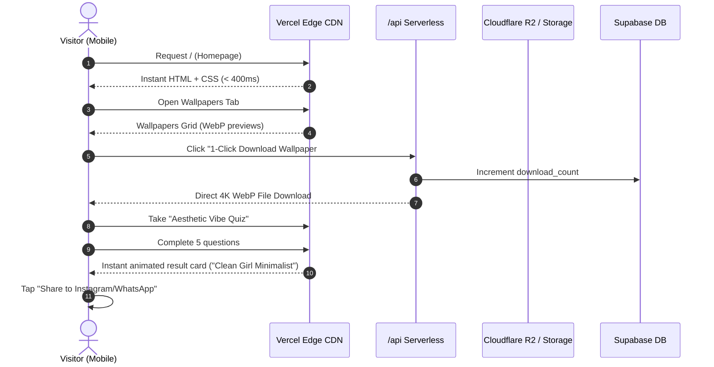
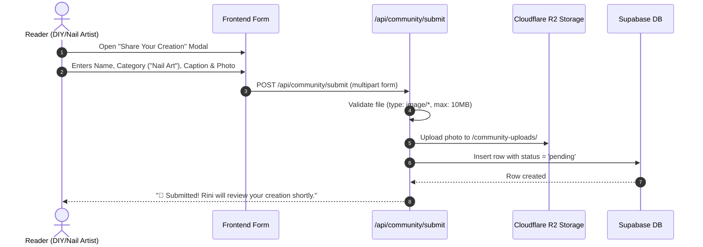
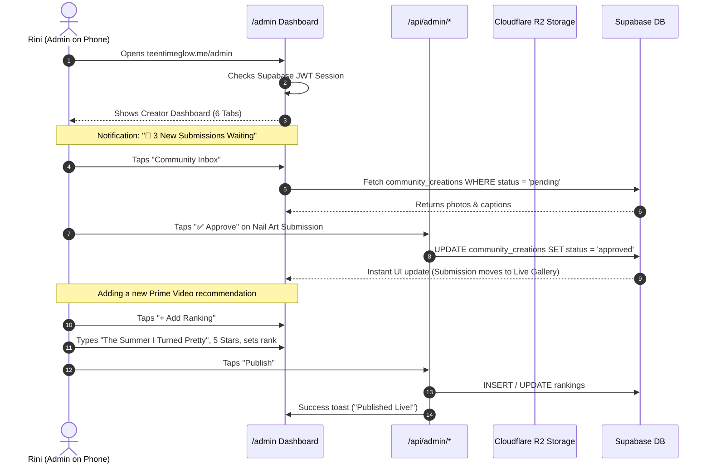

# End-to-End System Map — Rini TheTeen

This document maps all data flows, user journeys, moderation pipelines, and component relationships across **Rini TheTeen** (`teentimeglow.me`).

---

## 1. High-Level System Map

```
┌─────────────────────────────────────────────────────────────────────────────┐
│                          CLIENT LAYER (Edge Devices)                        │
│                                                                             │
│   [ Visitor Phone (85%) ]            [ Visitor Desktop ]         [ Rini (Admin) ]
└──────────────┬────────────────────────────────┬──────────────────────┬──────┘
               │                                │                      │
               ▼                                ▼                      ▼
┌─────────────────────────────────────────────────────────────────────────────┐
│                      VERCEL GLOBAL EDGE NETWORK                             │
│                                                                             │
│  ├── Edge Cache (HTML, WebP Wallpapers, Static CSS/JS)                      │
│  │     └── Hit Rate: ~95% (Latency: 20-50ms)                                │
│  │                                                                          │
│  └── Edge Serverless Functions (/api/* & /admin SSR)                        │
│        ├── /api/community/submit  (Rate Limited)                           │
│        ├── /api/wallpapers/download                                         │
│        ├── /api/admin/* (Protected by Supabase JWT)                         │
│        └── Dynamic Quiz Engine Router                                       │
└──────────────┬────────────────────────────────┬──────────────────────┬──────┘
               │                                │                      │
               ▼                                ▼                      ▼
┌───────────────────────────────────┐    ┌────────────────────────────────────┐
│      SUPABASE POSTGRESQL          │    │    CLOUDFLARE R2 / SUPABASE MEDIA  │
│                                   │    │                                    │
│  ├── posts                        │    │  ├── /wallpapers/ (Original 4K)    │
│  ├── rankings                     │    │  ├── /wallpapers/thumbs/ (WebP)    │
│  ├── quizzes / questions / options│    │  ├── /blog-media/ (WebP)           │
│  ├── community_creations          │    │  └── /community-uploads/ (Pending) │
│  ├── stories_memes_quotes         │    │                                    │
│  └── Row-Level Security (RLS)     │    │  Zero Egress Bandwidth Charges     │
└───────────────────────────────────┘    └────────────────────────────────────┘
```

---

## 2. Core User Journey Maps

### Journey A: Public Visitor (Mobile Browsing & Freebies)


---

### Journey B: Community Member (Submitting a Creation)


---

### Journey C: Rini (Zero-Code Moderation & Content Publishing)


---

## 3. Data Flow & Moderation Pipeline

```
[ Reader Uploads Photo ] 
          │
          ▼
   [ Server Validation ] ───(Invalid MIME / >10MB)───> [ 400 Bad Request ]
          │ (Valid)
          ▼
   [ Save to Storage ] ──> /community-uploads/<uuid>.webp
          │
          ▼
   [ Insert DB Row ] ────> status = 'pending' (HIDDEN FROM PUBLIC)
          │
          ▼
   [ Rini's Private Inbox ] ──> Displays image, caption, submitter name
          │
          ├─── [ Rini Taps "Reject" ] ───> DELETE file & row
          │
          └─── [ Rini Taps "Approve" ] ──> UPDATE status = 'approved' ──> [ LIVE ON SITE ]
```

---

## 4. Edge Caching & Content Invalidation Flow

* **Static Reads**: Visitors requesting `/blog`, `/rankings`, `/wallpapers` hit the **Vercel Edge Cache**.
* **Zero Database Load**: 99% of visitor traffic is served from Edge memory.
* **On-Demand Cache Purging**:
  * When Rini saves a new blog post or updates a ranking in `/admin`, the API route sends a tag-based revalidation signal (`res.revalidate('/blog')`).
  * The edge cache refreshes within **5 seconds** without rebuilding the entire site.

---

## 5. System Component Dependency Graph

```
teentimeglow.me (Staging: rinitheteen.vercel.app)
│
├── [ Frontend Pages (Astro) ]
│     ├── /                     (Home: Featured Hero, Quick Links, Daily Quote)
│     ├── /blog                 (Beauty, Fashion, Decor Articles)
│     ├── /blog/[slug]          (Full Article + Zoomable Lightbox + Lookbook)
│     ├── /rankings             (Prime Video & Audiobook Leaderboards)
│     ├── /quizzes              (Quiz Directory & Interactive Player)
│     ├── /community            (The Teen Gallery: Approved DIY/Nails/Art)
│     ├── /wallpapers           (Free Mobile/Desktop Wallpaper Vault)
│     ├── /stories-and-memes    (Relatable Feed)
│     └── /admin                (Private Creator Dashboard for Rini)
│
├── [ Serverless API Handlers (/src/pages/api) ]
│     ├── /community/submit.ts
│     ├── /wallpapers/download.ts
│     ├── /admin/auth.ts
│     ├── /admin/upload.ts
│     └── /admin/crud.ts
│
└── [ External Free Infrastructure ]
      ├── Supabase Cloud       (Auth + PostgreSQL Engine + RLS)
      ├── Cloudflare R2        (Object Storage + Zero Egress Bandwidth)
      ├── Google Analytics 4   (GA4 Performance & Visitor Telemetry)
      └── Vercel Platform      (SSL, Edge Routing, Git Deployments)
```
